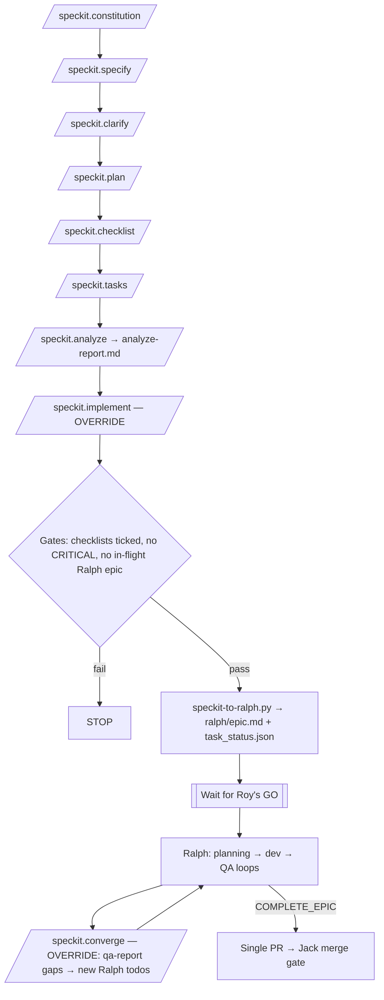

# Spec Kit → Ralph workflow (trial)

Spec Kit gives the authoring structure. **Ralph is the only execution path.** The `ralph-handoff` preset replaces `/speckit.implement` and `/speckit.converge`, so neither one writes product code.

## Sequence
1. Constitution, specify, clarify, plan, checklist, tasks, analyze: stock Spec Kit. Save the analyze output to `FEATURE_DIR/analyze-report.md`.
2. `/speckit.implement` (override):
   - Checks the gates.
   - Runs `python3 .specify/scripts/speckit-to-ralph.py FEATURE_DIR`.
   - Stops at **Start Ralph now?**
3. After Roy says go, Ralph runs as usual. Only QA sets `passes: true`.
4. `/speckit.converge` (override) adds `ralph/qa-report.md` GAP/FAIL lines as new todos in `ralph/task_status.json`. It never edits `tasks.md`.
5. When the epic is complete: one PR, then the Jack merge gate.

## Source of truth
After handoff, `ralph/task_status.json` is the source of truth. Spec Kit's `tasks.md` becomes read-only input.

## Guard
`.specify/scripts/check-ralph-handoff.sh` fails if either skill has lost the `RALPH-HANDOFF-PRESET` marker. It is not wired into CI. Run it after any `specify` upgrade or preset change.

## Caveats (from the trial, specify-cli 1.2.0)
- The override survived `integration upgrade` (blocked with a modified-files warning), `upgrade --force`, `preset update`, re-running `init --force`, and `integration use`.
- **`specify preset remove ralph-handoff` restores the stock implement and converge.** That is the one way a second path can return.
- The handoff is a prompt to the agent, not a hard lock. The converter's own checks (in-flight refusal, unmapped requirements) are enforced in code.
- The `analyze-report.md` gate is a project convention. Stock analyze does not save a report.
- Reinstall the preset with `specify preset add --dev .specify/ralph-handoff-preset`.

See `docs/speckit-ralph-trial-report.md`. `specs/005-mac-present-fullscreen/` is an example only.
